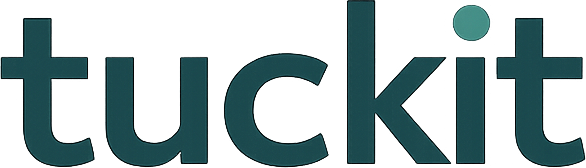
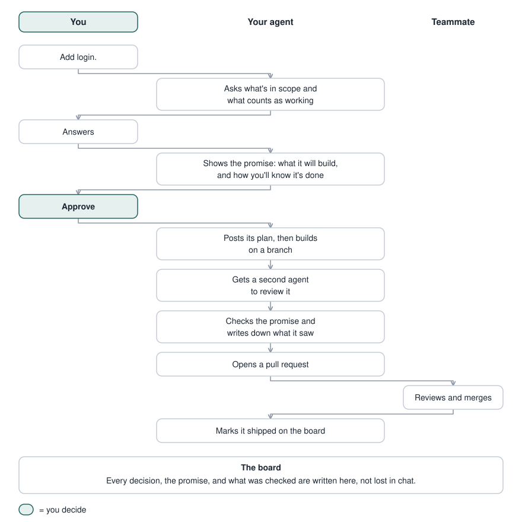

<p align="center">
  <picture>
    <source media="(prefers-color-scheme: dark)" srcset="docs/media/wordmark-dark.png">
    
  </picture>
</p>

<h1 align="center">tuckit-plugins</h1>

<p align="center">
  Put your coding agent on the same project board you read.<br>
  Claude Code, Codex CLI and Antigravity CLI.
</p>

<p align="center">
  <a href="https://tuckit.dev">Website</a> &middot;
  <a href="https://docs.tuckit.dev">Docs</a> &middot;
  <a href="https://app.tuckit.dev">Get a workspace</a> &middot;
  <a href="LICENSE">MIT</a>
</p>

---

[tuckit](https://tuckit.dev) is a project board that you and your coding agents
share. You use it in the browser; your agent uses the same board over MCP.

As agents get better at writing code, the part that stays yours is deciding
what "done" means. This plugin is built around that. **You write down what
would have to be true for the work to count as finished. The agent builds it,
checks exactly those things, and writes down what it actually saw.** Both stay
on the board, so anyone can see later what was promised and what was proven.

<p align="center">
  <picture>
    <source media="(prefers-color-scheme: dark)" srcset="docs/media/workflow-dark.svg">
    
  </picture>
</p>

## Building one feature, start to finish

Say your app has no login yet, and you type:

> **You:** Add login.

**1. It asks before it guesses.** "Login" could mean a lot of things, so the
agent reads your code and asks only what changes the outcome:

> **Agent:** Should each user see only their own notes, or does everyone share
> one list? And do people sign up themselves, or do you create the accounts?

It does not ask which library to use or how to store passwords. That part is
its job.

**2. You approve one thing: the promise.** The agent writes down what it will
build and why, and what you would see when it is done:

> **What:** The notes API requires login. Accounts come from your config.
> Everyone shares one list. Sign-up and password reset are out of scope.
>
> **Done when:** Calling the API without a valid token gets a 401 and changes
> nothing. A wrong password gets a 401. The right one gets a token that works.

You say yes. This is the only time the agent stops and waits for you.

**3. It builds, and tells you how before it starts.** A short message with its
plan, then it gets on with it on a branch. Each real choice it makes ("random
tokens kept in memory, not signed ones, because...") is recorded on the board.
If you disagree with any of them, say so and it changes course.

**4. It proves it.** A second agent reviews the branch. Then it checks each line
of "done when" against the running app and writes down what it actually saw,
including what it could not check:

> **Evidence:** No token: 401, list unchanged. Wrong password: 401, no token.
> Right password: token returned, notes load. Not checked: behaviour after a
> server restart.

The board will not let the work ship until this exists.

**5. It hands you a pull request.** A teammate reviews and merges it, and the
board marks the work shipped.

Anything the agent noticed along the way but did not do, say a flaky test,
lands in the board's Inbox as a short note for you to file or throw away later.

**In a team,** everyone installs the plugin and points it at the same
workspace. An agent claims a piece of work before it starts, and leaves work
someone else has claimed alone.

**Small things skip step 2.** For a typo or a version bump, the agent writes
the promise itself and goes straight to the pull request.

## Install

You need a tuckit workspace ([app.tuckit.dev](https://app.tuckit.dev)) and
Python 3 on your `PATH`.

### Claude Code

```
/plugin marketplace add tuck-it/tuckit-plugins
/plugin install tuckit@tuckit-plugins
```

Press Enter to accept the default MCP URL. The first time the agent uses the
board, your browser opens to sign in. There is no token to paste.

### Codex CLI

```
codex plugin marketplace add tuck-it/tuckit-plugins
```

Then in a session, `/plugins` → **tuckit** → install → enable. Codex needs a
token, which you create in tuckit under **Settings > Access tokens**:

```bash
export TUCKIT_MCP_TOKEN="<YOUR_TOKEN>"    # add to your shell profile to keep it
```

### Antigravity CLI

```bash
agy plugin install https://github.com/tuck-it/tuckit-plugins/tree/main/plugins/antigravity
```

Then run `/mcp` once and approve tuckit in the browser. Until you do, the agent
cannot see the board at all.

Use the URL above as written. Pointing `agy` at the repository root installs
the Claude Code plugin as well, and the two break each other's hooks.

### Check it works

Start a new session and ask "what's the state of this project?". The agent
should answer from your board.

<details>
<summary>Troubleshooting and other setups</summary>

**Claude Code**
- Working from a clone: `/plugin marketplace add ./tuckit-plugins`.
- Not picked up: `/reload-plugins`, then `/plugin list`.
- Your own MCP URL, without the prompt:
  `claude plugin install tuckit@tuckit-plugins --scope user --config mcp_url="<YOUR_MCP_URL>"`.
- A server you added yourself with `claude mcp add tuckit` takes precedence
  over the plugin's.

**Codex CLI**
- A different workspace URL: edit `url` in `plugins/codex/.mcp.json`.
- Codex has no session-end hook that can reach the model, so the session-start
  text asks it to tidy the board when it finishes.
- The hooks were checked against codex-cli 0.154.0; the bundled `.mcp.json` has
  not been checked the same way.

**Antigravity CLI**
- Working from a clone: `agy plugin install ./plugins/antigravity`.
- A different workspace URL: edit `serverUrl` in
  `plugins/antigravity/mcp_config.json` before installing.
- The agent cannot find tuckit: run `/mcp`. `agy mcp list` does not show
  servers that come from a plugin, so it is no evidence either way.
- A clean reinstall: `agy plugin uninstall tuckit`, then delete
  `~/.gemini/config/plugins/tuckit/`.
- Problems loading hooks show up in `~/.gemini/antigravity-cli/log/cli-*.log`,
  not in the install output.

**Connecting the MCP by hand**
- Claude Code: `claude mcp add --transport http tuckit <YOUR_MCP_URL>`
- Codex, in `~/.codex/config.toml`:
  ```toml
  [mcp_servers.tuckit]
  url = "<YOUR_MCP_URL>"
  bearer_token_env_var = "TUCKIT_MCP_TOKEN"
  ```
- Antigravity, in `~/.gemini/config/mcp_config.json`:
  ```json
  { "mcpServers": { "tuckit": { "serverUrl": "<YOUR_MCP_URL>" } } }
  ```
</details>

## The skills

The agent picks the right one on its own. You can also call any of them by name.

| Skill | When it runs |
|---|---|
| **`starting-with-tuckit`** | Once, when your board is empty. Proposes the first Areas and work for you to approve. |
| **`designing-a-slice`** | Steps 1–2 above: turns a request into a promise you approve. |
| **`building-a-slice`** | Steps 3–5: builds what you approved, checks it, opens the PR, marks it shipped after the merge. |
| **`reviewing-a-change`** | The second-agent review in step 4, and handling review comments on the PR. |
| **`reconciling-the-board`** | End of a session. Tidies the work you hold and asks before adding anything new. |
| **`tending-the-board`** | When the Inbox or the board has piled up. Proposes what to file or close, in one list. |
| **`tuckit-domain`** | Reference for how the board works. |

The plugin also adds short hooks: a note at the start of each session that this
project is tracked in tuckit, and a one-line reminder on each request to put
work on the board before changing code.

## Contributing

Edit `shared/` only. Everything under `plugins/<agent>/` except each agent's
manifest and hooks is generated from it. After a change:

```bash
python3 scripts/build.py         # regenerate plugins/<agent>/
python3 -m pytest                # tests, including that the build is current
python3 scripts/check_drift.py   # shared content may name only get_project_state
```

Do not write counts in prose ("seven skills"); they go wrong silently the next
time something is added.

## License

MIT. See [LICENSE](LICENSE) and [NOTICE](NOTICE).
